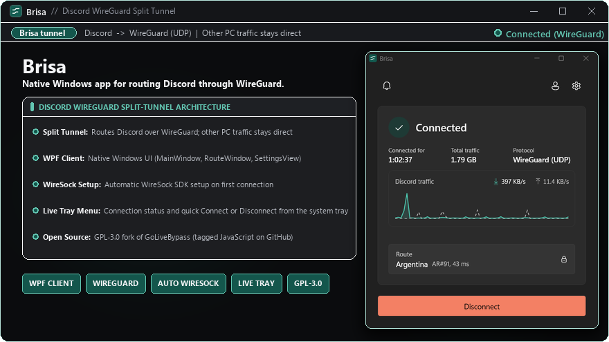

<table width="100%">
  <tr>
    <td valign="middle">
      <b>Nate</b> &nbsp;·&nbsp; fullstack dev, Node.js on the backend
      <a href="https://x.com/osomdasilva" title="X"><picture><source media="(prefers-color-scheme: dark)" srcset="https://cdn.simpleicons.org/x/ffffff"></picture></a>
      
      <a href="mailto:nate@insxnsive.works" title="Email"><picture><source media="(prefers-color-scheme: dark)" srcset="https://cdn.simpleicons.org/proton/ffffff"></picture></a>
    </td>
  </tr>
</table>

Information Systems student at IBMR. Alura fullstack degree, May 2022.

  
  

## Stack

<table width="100%">
  <tr>
    <td>
      <b>front-end</b> 
      
      
      
      
      
      
      
      
      
      
    </td>
  </tr>
  <tr>
    <td>
      <b>back-end</b> 
      
      
      
      
      
      
      
      
    </td>
  </tr>
  <tr>
    <td>
      <b>desktop</b> 
      
      
    </td>
  </tr>
  <tr>
    <td>
      <b>database &amp; infrastructure</b> 
      
      
      
      
      
      
    </td>
  </tr>
</table>

---

built by my favorite agent &amp; reviewed by me.
