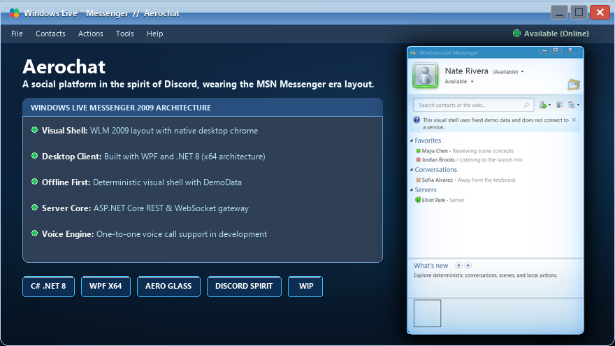
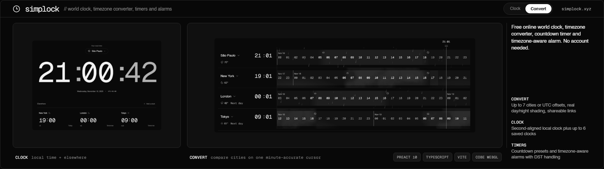

<table width="100%">
  <tr>
    <td valign="middle">
      <b>Nate</b> &nbsp;·&nbsp; AI Engineer, Node.js on the backend
      <a href="https://x.com/osomdasilva" title="X"><picture><source media="(prefers-color-scheme: dark)" srcset="https://cdn.simpleicons.org/x/ffffff"></picture></a>
      
      <a href="mailto:insxnsive@proton.me" title="Email"><picture><source media="(prefers-color-scheme: dark)" srcset="https://cdn.simpleicons.org/proton/ffffff"></picture></a>
    </td>
  </tr>
</table>

Self-taught since 04/2020. Information Systems student at IBMR. Alura fullstack degree, May 2022.

  
  
   
  

  <picture>
    <source media="(prefers-color-scheme: dark)" srcset="https://github-readme-stats.vercel.app/api?username=insxnsive&show_icons=true&hide_border=true&bg_color=00000000&title_color=f4f5f7&text_color=b6bac1&icon_color=63c6b2&ring_color=63c6b2" />
    
  </picture>

<table width="100%">
  <tr>
    <td>
      <b>front-end</b> 
      
      
      
      
      
      
      
      
      
      
    </td>
  </tr>
  <tr>
    <td>
      <b>back-end</b> 
      
      
      
      
      
      
      
      
    </td>
  </tr>
  <tr>
    <td>
      <b>desktop</b> 
      
      
    </td>
  </tr>
  <tr>
    <td>
      <b>database &amp; infrastructure</b> 
      
      
      
      
      
      
    </td>
  </tr>
</table>

---

built by my favorite agent &amp; reviewed by me.
